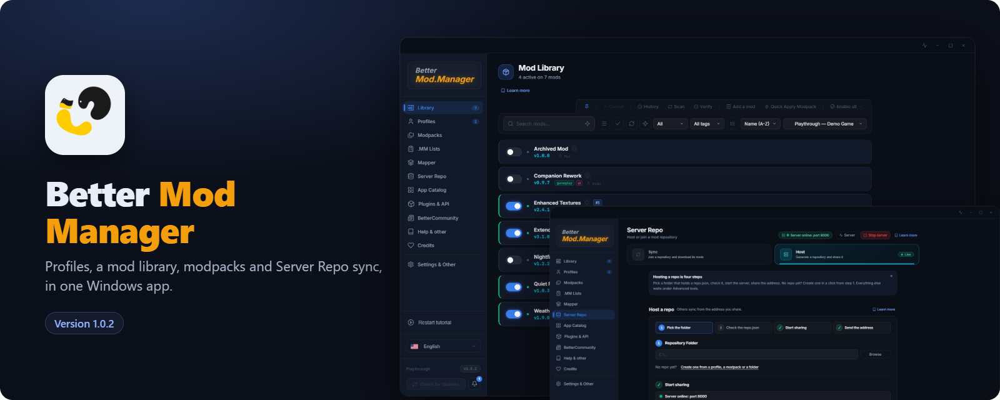
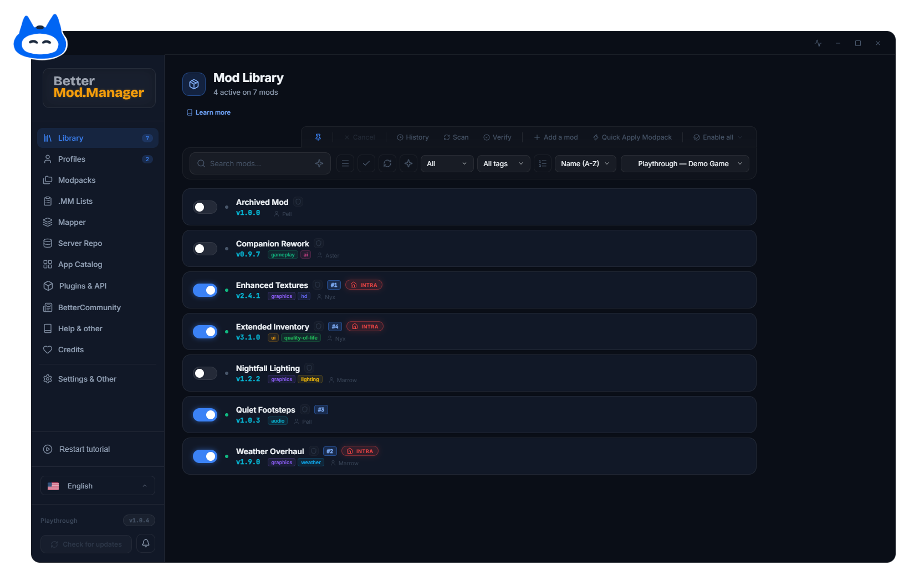
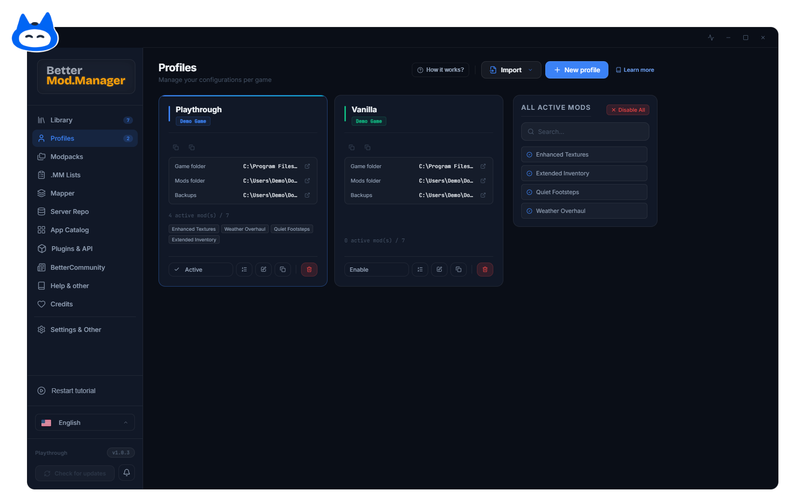
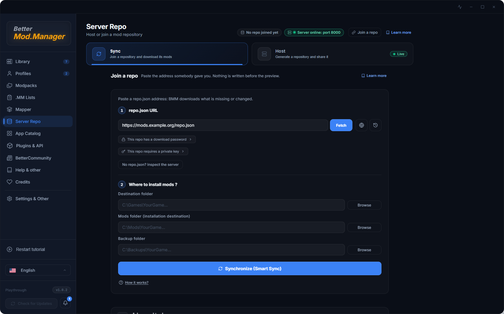
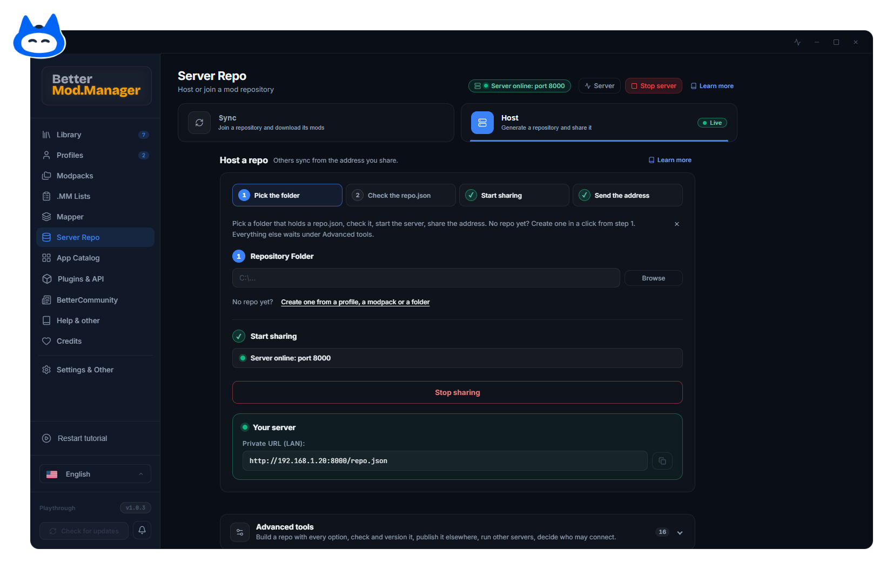
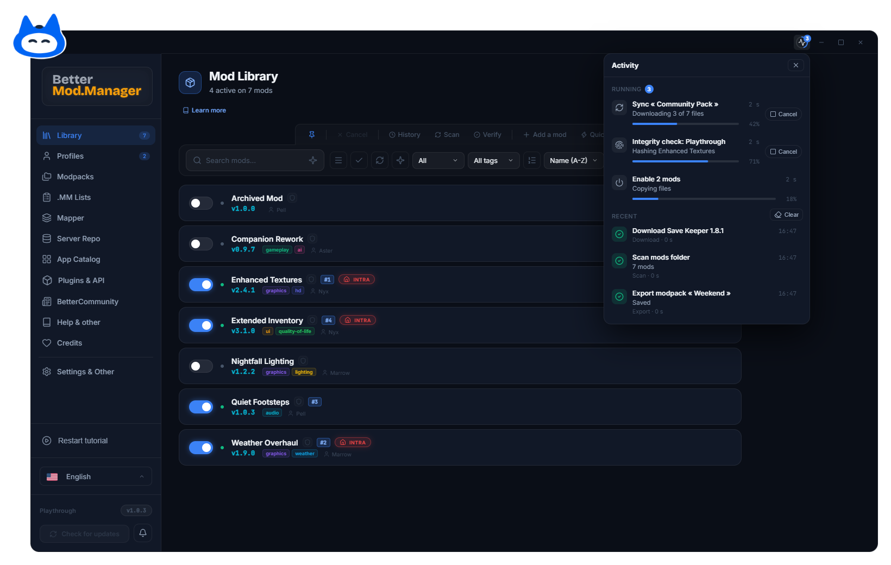
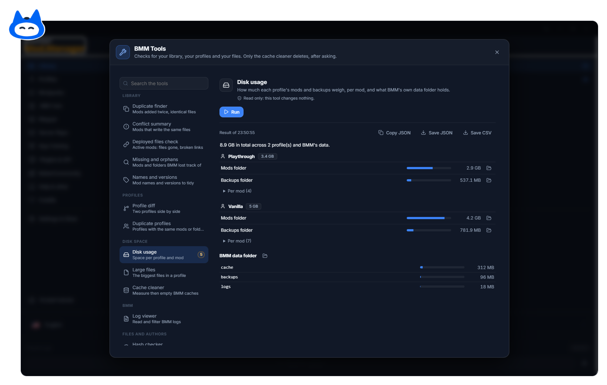
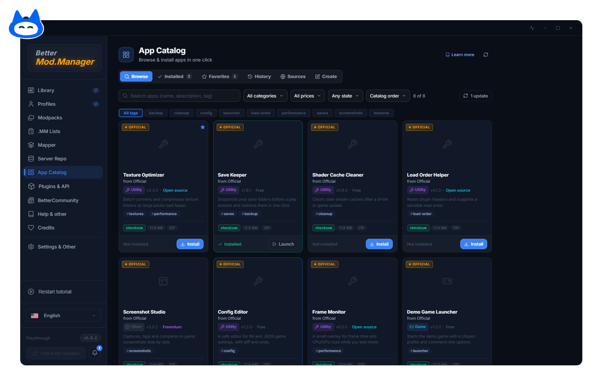
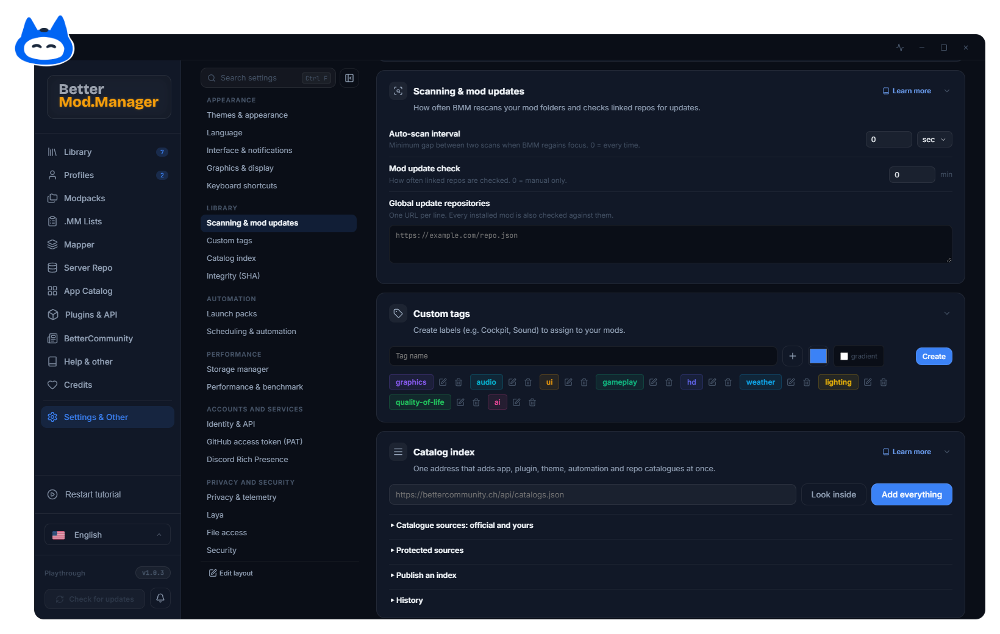
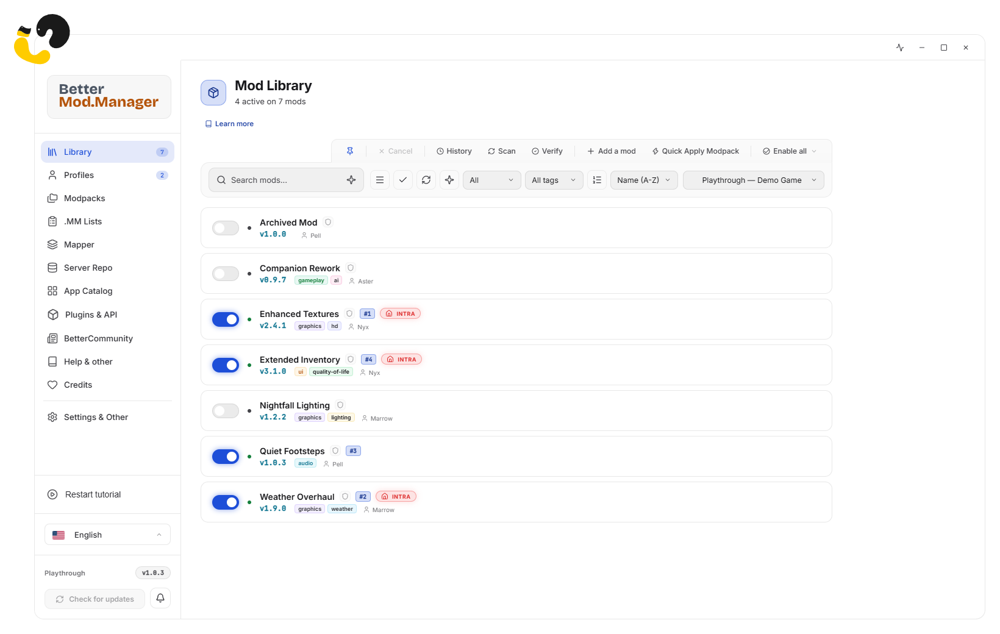

<div align="center">

  

  # Better Mod Manager

  **Un gestionnaire de mods universel pour Windows : profils, bibliothèque de mods, modpacks et synchronisation Serveur Repo.**

  
  
  
  
  

  [Télécharger](https://github.com/FreeProject089/BetterModsManager/releases/latest) •
  [Documentation](https://bettercommunity.ch/docs) •
  [Discord](https://discord.gg/CTaaEF9R75) •
  [Ko-fi](https://ko-fi.com/I2I31ZIPPG) •
  [English](README_EN.md)

</div>

---

## Ce que c'est

Better Mod Manager (BMM) sépare vos mods de vos configurations. La **Bibliothèque** contient
tous les mods que vous possédez ; un **Profil** décide lesquels sont actifs, et dans quel ordre,
pour un jeu. Activer un mod copie ses fichiers dans le jeu, sauvegarde ce qu'il remplace et
enregistre des empreintes SHA-256 : un profil peut donc toujours être désactivé proprement, et
une mise à jour ou une réinstallation du jeu n'emporte jamais vos mods.

En plus : des modpacks, des listes `.MM` à partager, des dépôts dont vous pouvez vous
synchroniser ou que vous hébergez vous-même, un catalogue d'applications, une aide IA hors ligne
facultative, un planificateur, des plugins, des thèmes, ainsi qu'une CLI, un serveur MCP et une
API locale pour l'automatisation.

## Captures d'écran

| | |
|---|---|
|  **Bibliothèque** : mods étiquetés, filtres, ordre de chargement, un interrupteur par mod. |  **Profils** : une configuration par jeu, ou plusieurs par jeu. |
|  **Serveur Repo, Se synchroniser** : collez l'adresse d'un `repo.json`, prévisualisez, puis synchronisez. |  **Serveur Repo, Héberger** : des étapes numérotées et la carte du serveur en marche. |
|  **Centre d'activité** (nouveau en 1.0.2) : chaque tâche en cours, avec Annuler. |  **Outils BMM** (nouveau en 1.0.2) : des vérifications en lecture seule, ici l'espace disque par profil. |
|  **Catalogue d'applications** : chaque carte indique son état et l'action suivante. |  **Paramètres** : un index de toutes les cartes, avec recherche (Ctrl+F). |

<p align="center"><br/><sub>La même Bibliothèque avec le thème clair intégré. Captures réalisées avec des données de démonstration, interface en anglais.</sub></p>

Plus d'images, domaine par domaine : [VISUALS_FR.md](VISUALS_FR.md).

## Fonctionnalités

- **Bibliothèque** : tous vos mods, avec étiquettes, recherche, filtres, contrôle d'intégrité SHA-256 et détection des conflits avant toute écriture.
- **Profils** : un dossier de jeu, un dossier de mods, un dossier de sauvegarde et un ensemble de mods actifs par profil ; on bascule en un clic.
- **Modpacks et listes `.MM`** : activez tout un lot d'un coup, ou transmettez votre configuration exacte (liens compris).
- **Serveur Repo** : synchronisez des mods depuis un `repo.json`, suivez un dépôt pour ses mises à jour, ou hébergez le vôtre depuis BMM ou avec le mini-serveur autonome.
- **Catalogue d'applications** : les outils autour du modding, installés, lancés et mis à jour depuis une seule page.
- **Mapper** : corrige un mod dont les dossiers ne correspondent pas à ce qu'attend le jeu.
- **Laya (IA facultative)** : propose les informations d'un mod et vérifie les rapports de bug ; le modèle hors ligne intégré n'envoie rien nulle part.
- **Planificateur et BMMScript** : des tâches avec déclencheurs, conditions et boucles, écrites dans l'éditeur ou en BMMScript ; les étapes sensibles demandent des permissions accordées une par une.
- **Plugins et API** : étendez BMM avec des plugins, des liens profonds (`bmm://`) et une API HTTP locale.
- **Thèmes** : des thèmes intégrés (sombres et clair), un éditeur de thèmes et un catalogue de thèmes.
- **CLI et MCP** : `bmm-mcp-server.exe` pilote BMM depuis un script ou depuis un agent IA via MCP.
- **Aide intégrée** : articles bilingues, tutoriels interactifs et palette de commandes (Ctrl+K).

## Nouveautés de la 1.0.3

La liste complète est dans le [journal des modifications 1.0.3](Update/changelog_v1.0.3_FR.md). L'essentiel :

- **Des mises à jour en un clic qui fonctionnent à nouveau** : téléchargement, vérification par le manifeste signé de la version, installation. Canal stable ou préversion, vérification en arrière-plan facultative.
- **Centre d'activité** : un bouton dans la barre de titre liste chaque tâche en cours (activation, téléchargements, synchronisation, analyses, exports, travaux de Laya…) avec sa progression et Annuler, ainsi que les 30 dernières terminées.
- **Outils BMM** : recherche de doublons, résumé des conflits, espace disque, comparaison de profils, mods manquants et orphelins, vérificateur d'empreintes, validateur de manifeste et de catalogue ; résultats exportables en JSON ou CSV.
- **Serveur Repo simplifié** : étapes guidées pour Se synchroniser et Héberger, une zone « Outils avancés », des dépôts suivis, un flux Atom, des versions de format de dépôt, et un mini-serveur autonome avec page d'état et tâches planifiées.
- **Paramètres** : un index de toutes les cartes, une recherche, et une disposition réorganisable depuis l'index.
- **Catalogue d'applications et catalogues** : des cartes plus claires, un filtre par état d'installation, un format de catalogue versionné unique.
- **Mes consentements** : chaque réponse sur les Conditions, la Politique de confidentialité et la télémétrie laisse un reçu infalsifiable que vous pouvez consulter et exporter.
- **Démarrage** : l'intro classique de Tasky revient, plus légère (Classique, Logo ou Désactivée) ; nouveau thème intégré « BMM Logo ».

## Installation

1. Téléchargez **`BMM-Setup.exe`** depuis la [dernière version](https://github.com/FreeProject089/BetterModsManager/releases/latest).
2. Lancez-le. Windows peut afficher SmartScreen la première fois : **Informations complémentaires → Exécuter quand même**.
3. Lancez BMM.

Prérequis : Windows 10 ou 11 avec WebView2 (présent sur Windows 11 et sur un Windows 10 à jour).
`BMM-Setup.exe` est construit avec [BetterInstaller](https://github.com/FreeProject089/BetterInstaller) :
il vérifie la signature Ed25519 du paquet avant d'écrire quoi que ce soit, installe par
utilisateur par défaut, et sert aussi d'outil de maintenance (mise à jour, réparation,
désinstallation).

**Mettre à jour**

| Vous avez | Que faire |
|---|---|
| 1.0.x | Acceptez la mise à jour proposée par BMM. Une installation BetterInstaller se met à jour sans question : BMM lance `BMM-Setup.exe --update`, qui attend la fermeture de BMM, installe par-dessus en gardant votre dossier et vos choix, puis le relance. |
| 0.9.11 | Acceptez la mise à jour vers **0.9.12** (une version passerelle), puis celle vers 1.0.2 qu'elle propose ensuite. |
| Plus ancienne | Téléchargez `BMM-Setup.exe` depuis la page de la version et lancez-le. Vos données sont conservées. |

Le même programme de mise à jour peut être lancé à la main ou depuis un script ; voir la
[ligne de commande de BetterInstaller](https://github.com/FreeProject089/BetterInstaller/blob/master/GUIDE_FR.md#ligne-de-commande--installer-mettre-à-jour-réparer-modifier-désinstaller-sans-surveillance).

## Confidentialité

BMM ne demande aucun compte et n'affiche aucune publicité ; vos profils, mods et réglages restent
sur votre PC. La télémétrie est **désactivée tant que vous n'avez pas dit oui**, dans
l'installateur ou sur l'écran de consentement de BMM, et se désactive à nouveau dans Paramètres →
Confidentialité & télémétrie. Certaines connexions sont actives par défaut (vérification des mises à jour,
liste des liens, test de connexion, polices et icônes) ; chacune est listée avec son moyen de la
couper dans la [Politique de confidentialité](PRIVACY_FR.md). Chaque réponse que vous donnez laisse
un reçu de consentement versionné et haché, conservé sur votre PC et listé dans Paramètres →
Confidentialité & télémétrie → **Mes consentements**.

## Documentation et aide

- **Documentation** : <https://bettercommunity.ch/docs> (guide d'utilisation, fonctionnement interne, références API, CLI et MCP, en français et en anglais)
- **Dans l'application** : **Help & other**, et **Ctrl+K** pour tout rechercher
- **Discord** : <https://discord.gg/CTaaEF9R75>
- **Versions** : <https://github.com/FreeProject089/BetterModsManager/releases>
- **Signaler un bug** : [GitHub Issues](https://github.com/FreeProject089/BetterModsManager/issues), ou **Paramètres → Feedback & Rapports de bugs** dans BMM
- **Contribuer** : [Carte du dépôt](REPO_MAP_FR.md) · [Contribuer](CONTRIBUTING_FR.md) · [Politique de sécurité](SECURITY_FR.md)

## Compiler depuis les sources

Il vous faut Windows 10 ou 11, [Node.js](https://nodejs.org/) 22 (la version utilisée par la CI),
la chaîne d'outils [Rust](https://www.rust-lang.org/tools/install) stable et les
[prérequis de Tauri v2](https://v2.tauri.app/start/prerequisites/).

```bash
git clone https://github.com/FreeProject089/BetterModsManager.git
cd BetterModsManager
npm install
npm run dev     # surveillance TypeScript + l'application en mode développement
npm run build   # vérifications, compilation du frontend, build de l'application (sans installateur)
npm run ci      # toutes les vérifications, dans l'ordre de la CI
```

L'installateur se construit à part avec BetterInstaller (`npm run build:installer`). Toutes les
commandes sont listées dans la [référence des commandes](https://freeproject089.github.io/BMM-Docs/fr/reference/commands/).

## Licence

Better Mod Manager est un logiciel libre sous **licence publique générale GNU v3.0**. Voir
[LICENSE.md](LICENSE.md).
