# Thèmes de BMM

[English](THEMES.md) · **Français**

Better Mod Manager est livré avec quatorze thèmes intégrés, neuf sombres et cinq clairs, et un
éditeur de thème pour modifier n'importe lequel ou créer le vôtre. Un thème tient dans un petit
fichier (`.bmmtheme`) : vous pouvez l'exporter, l'envoyer à quelqu'un ou le publier dans un
catalogue de thèmes.

Chaque image ci-dessous est la vraie application, dans l'aperçu navigateur avec des données de
démonstration, habillée du thème.

- [Les thèmes intégrés](#les-thèmes-intégrés)
- [Créer le vôtre](#créer-le-vôtre)
- [Le partager](#le-partager)
- [Les jetons, en bref](#les-jetons-en-bref)
- [Le format du fichier](#le-format-du-fichier)
- [Pour aller plus loin](#pour-aller-plus-loin)

## Les thèmes intégrés

| | |
|---|---|
| **Default** · sombre<br>L'apparence d'origine : un fond bleu nuit profond, un accent bleu et des cartes vitrées douces.<br>`bmm-default`<br>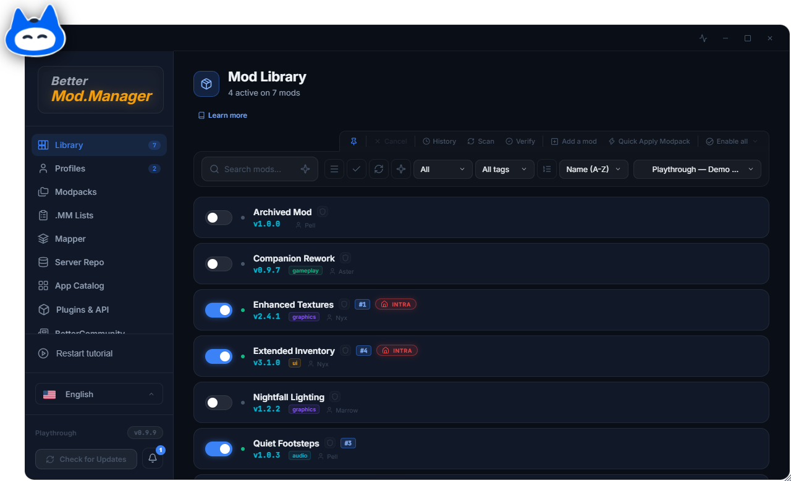 | **Graphite** · sombre<br>Un gris sombre et doux avec un accent indigo. Des surfaces calmes, peu contrastées.<br>`bmm-sombre`<br>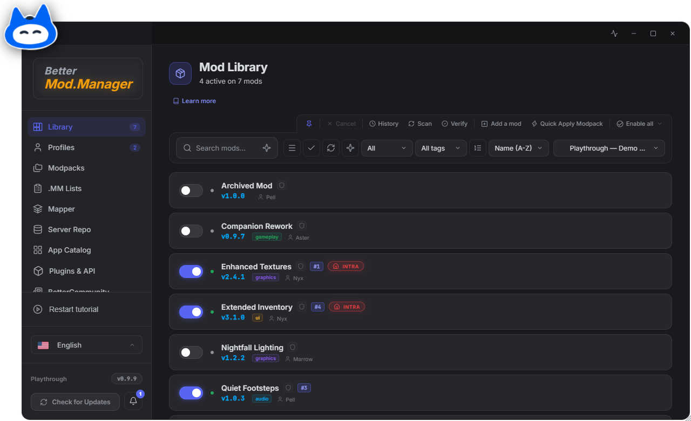 |
| **Pure Black** · sombre<br>Du vrai noir, un accent gris-blanc monochrome et des bordures très fines. Pour les écrans OLED et les soirées tardives.<br>`bmm-void`<br>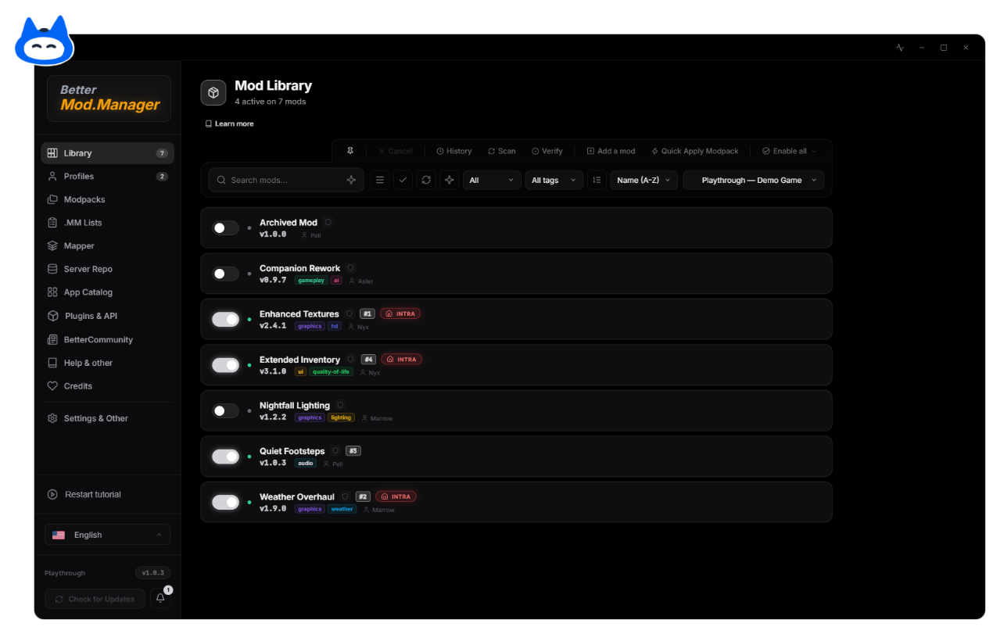 | **Daylight** · clair<br>Une interface claire et sobre : un fond gris clair, des cartes blanches nettes et un texte sombre.<br>`bmm-white`<br>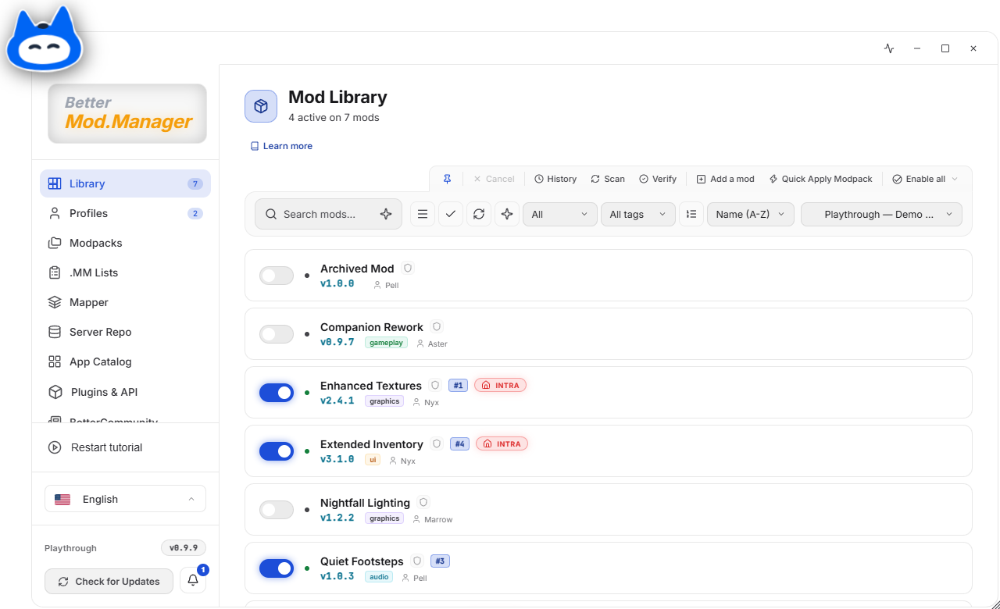 |
| **Indigo** · sombre<br>Des gris chauds superposés, un accent indigo et des coins de 8 px. Accueillant et familier.<br>`bmm-indigo`<br>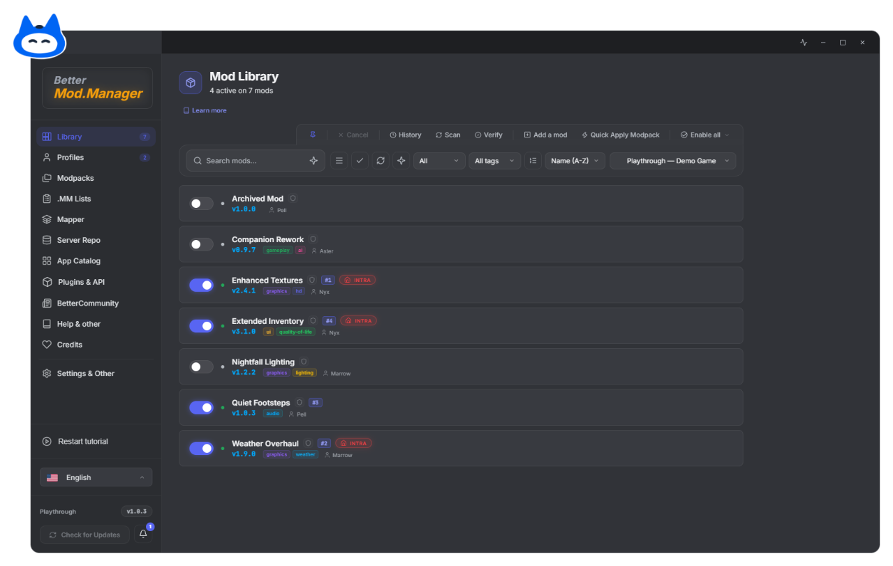 | **Ember** · sombre<br>Un noir profond avec un accent orange chaud et franc.<br>`bmm-orange`<br>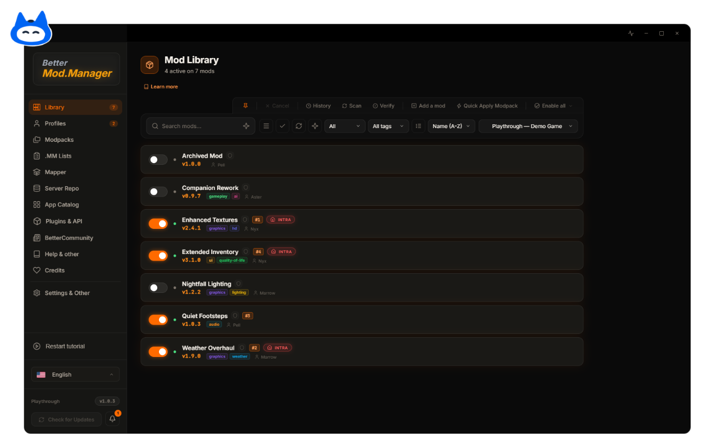 |
| **Neon** · sombre<br>Presque noir, avec un accent vert vif et des boutons en pilule.<br>`bmm-neon`<br>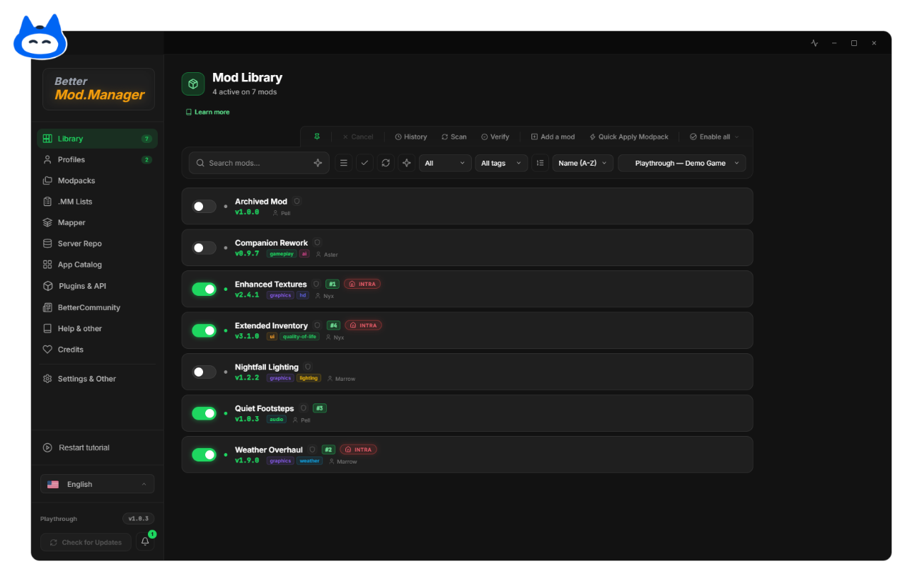 | **Newsprint** · clair<br>Néo-brutaliste : un fond papier chaud, aucun arrondi, des bordures d'encre et de grosses ombres décalées.<br>`bmm-brutal`<br>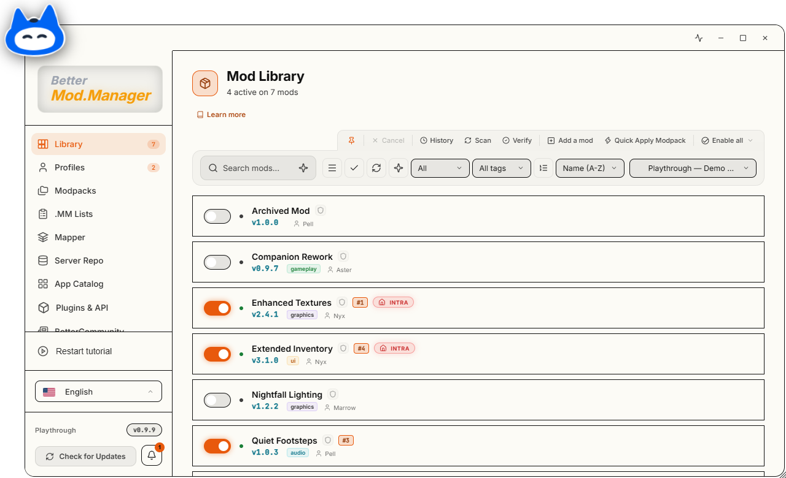 |
| **Clay** · clair<br>Calme et chaleureux : un fond crème doux, des bordures légères et un accent terre cuite.<br>`bmm-clay`<br>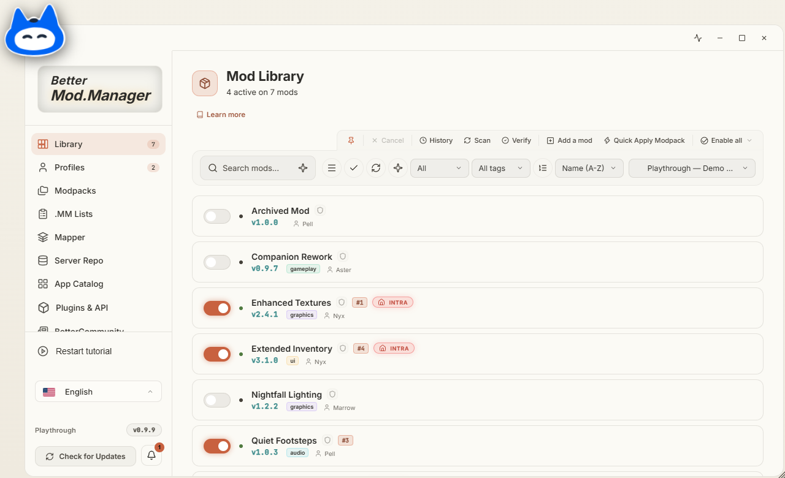 | **Arctic** · sombre<br>Frais et posé : des surfaces ardoise, un texte blanc neige et un accent bleu givre.<br>`bmm-arctic`<br>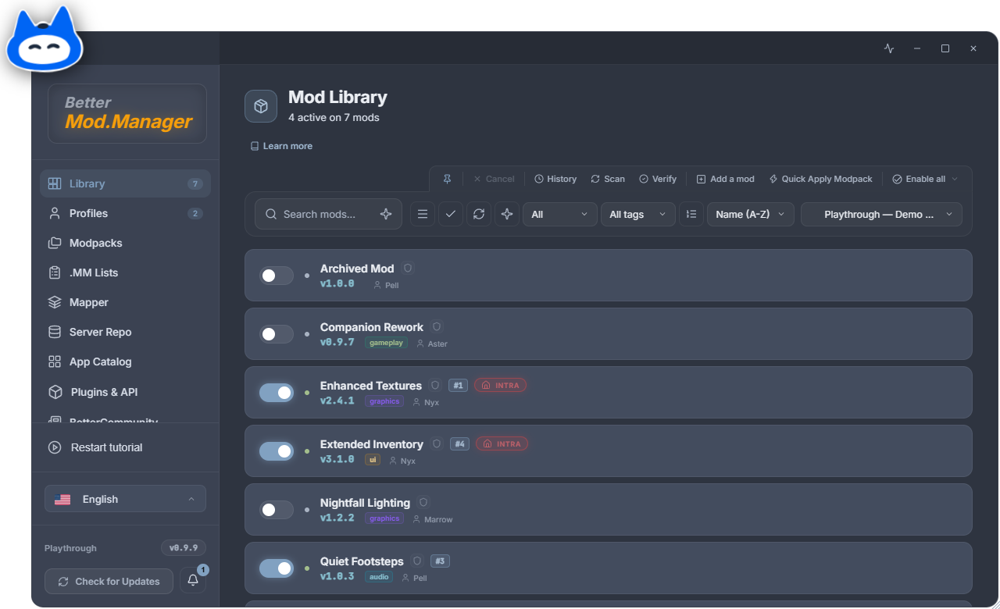 |
| **Blossom** · clair<br>Un thème clair et doux : un fond ivoire chaud, un accent rose pétale et un texte prune profond.<br>`bmm-sakura`<br>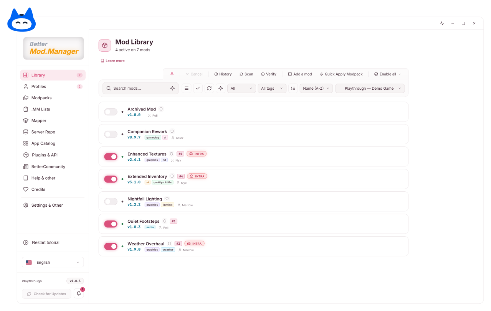 | **Charcoal** · sombre<br>Une allure de travail dense : des surfaces anthracite plates, des bordures de 1 px, un accent bleu de focus et de petits coins carrés.<br>`bmm-charcoal`<br>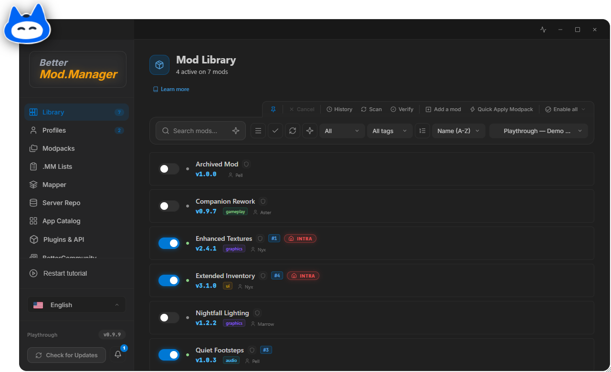 |
| **Cobalt** · sombre<br>Du graphite, des bordures très fines, des coins de 10 px et un accent bleu cobalt vif.<br>`bmm-cobalt`<br>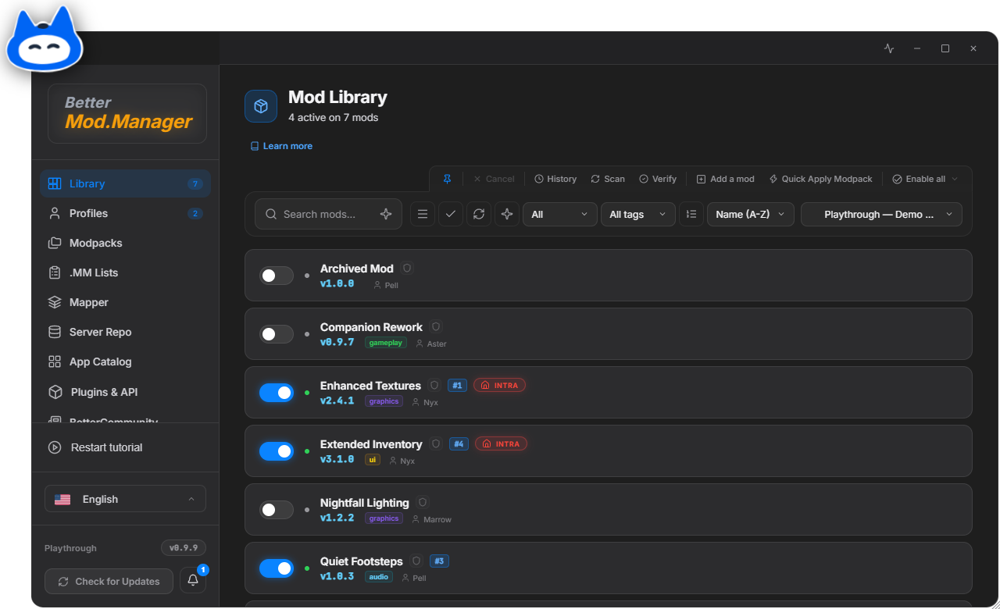 | **BMM Logo** · clair<br>Les couleurs du logo de BMM : un fond gris pâle, des formes noir d'encre et un jaune signal. Le logo remplace Tasky partout où la mascotte apparaît.<br>`bmm-logo`<br>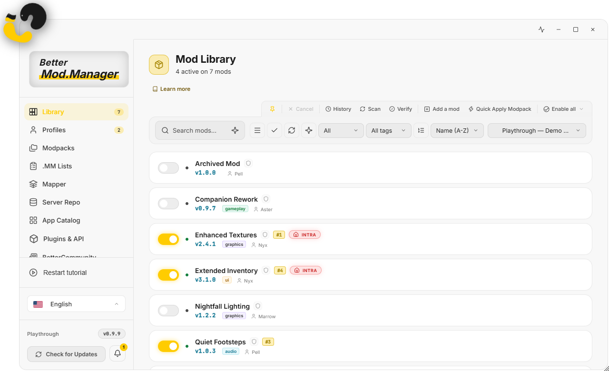 |

Le code sous chaque nom est l'identifiant du thème, celui qu'utilisent un lien
`bmm://theme/apply?id=…`, une tâche du planificateur ou le pont MCP.

**Tasky, le logo ou le badge.** Les thèmes ludiques (Default, Ember, Neon, Newsprint, Clay,
Blossom) gardent Tasky. Les thèmes sobres (Graphite, Pure Black, Daylight, Indigo, Arctic, Cobalt,
BMM Logo) montrent le logo de BMM, celui de l'icône de l'application, partout où Tasky
apparaîtrait : le coin, l'écran de démarrage, les pages vides et les fenêtres. Sur un thème sombre,
il est posé sur sa tuile pâle, comme dans l'icône. Charcoal montre le badge compact : les lettres
BMM sur une tuile de la couleur d'accent du thème.

> **Renommés en 1.0.4.** Six identifiants intégrés reprenaient le nom d'autres produits. Ils ont
> été renommés, les thèmes eux-mêmes n'ont pas changé, et les anciens identifiants fonctionnent
> toujours partout (votre choix enregistré, les thèmes masqués, les tâches planifiées, les liens,
> l'installateur, le pont MCP) :
>
> | Ancien identifiant | Nouvel identifiant |
> |---|---|
> | `bmm-discord` | `bmm-indigo` |
> | `bmm-spotify` | `bmm-neon` |
> | `bmm-claude` | `bmm-clay` |
> | `bmm-nord` | `bmm-arctic` |
> | `bmm-vscode` | `bmm-charcoal` (affiché auparavant comme *Editor*) |
> | `bmm-macos` | `bmm-cobalt` |

Choisissez un thème dans **Paramètres → Thèmes**, dans le **catalogue de thèmes**, ou depuis la
**Bibliothèque** de l'éditeur de thème. Un thème intégré dont vous ne vous servez pas peut être
masqué des listes, puis rétabli plus tard depuis le catalogue.

## Créer le vôtre

Ouvrez l'éditeur depuis **Paramètres → Thèmes → Éditeur** (ou le lien `bmm://theme/editor`). Il
flotte au-dessus de BMM, s'ancre sur le côté, ou s'ouvre dans une fenêtre à part.

1. **Partez de quelque chose de proche.** Dans **Essentiel**, choisissez un thème intégré sous
   *Partir de*, ou donnez votre accent à *Une palette à partir d'une couleur* pour qu'elle
   construise les fonds, les surfaces et le texte.
2. **Choisissez le mode.** *Sombre* ou *Clair*. Changer de mode reconstruit les fonds et le texte
   pour l'autre mode et garde votre accent et tout le reste : la version claire d'un thème sombre
   tient en un clic (puis *Enregistrer comme nouveau* pour garder les deux).
3. **Réglez les quatre familles** d'Essentiel : fond, surfaces, texte, accent et couleurs d'état.
   Tous les autres jetons sont dans **Tous les jetons**, avec une recherche par nom ou par ce qu'ils
   peignent, et un filtre *Modifiés seulement*.
4. **Regardez l'aperçu.** La partie droite montre de vrais éléments de BMM (barre latérale, cartes,
   boutons, champs, une boîte de dialogue, des notifications, une bulle d'aide) peints avec votre
   brouillon seulement. L'application elle-même ne change pas avant l'enregistrement, sauf si vous
   cochez *Appliquer à BMM pendant la saisie*.
5. **Vérifiez le contraste.** Sous l'aperçu, chaque paire qui doit rester lisible (texte principal
   sur le fond et sur les cartes, texte secondaire et discret, éléments de la barre latérale, texte
   des boutons principaux, notifications, bulles d'aide, couleurs d'erreur et de succès) affiche son
   ratio et son niveau WCAG. Une paire qui échoue propose **Corriger** : la couleur la plus proche
   qui passe, dans la même teinte (blanc ou presque noir pour le texte d'un bouton). *Tout corriger*
   les traite toutes.
6. **Allez plus loin si vous le souhaitez.** *Images* choisit entre Tasky et le logo de BMM, et
   remplace Tasky, le logo latéral ou le fond d'écran par vos propres images (les fichiers sont
   intégrés au thème). *Éléments* restyle un type d'élément (désignez-le
   à l'écran d'un clic droit) ou ajoute vos propres boutons et bannières. *CSS* accepte n'importe
   quel CSS, pour toute l'application ou une seule page.
7. **Enregistrez.** *Enregistrer* écrase votre propre thème ; sur un thème intégré, il en
   enregistre une copie. *Enregistrer comme nouveau* crée toujours un nouveau thème. Annuler et
   rétablir (Ctrl+Z, Ctrl+Y) couvrent chaque modification, et le bouton de réinitialisation annule
   les modifications non enregistrées ou repart de l'apparence par défaut.

Le pied de l'éditeur indique si le fichier est valide. Un problème qui empêcherait le thème de se
charger (un identifiant dangereux, une valeur qui sortirait de la feuille de style) s'affiche
avant l'enregistrement.

## Le partager

- **Fichier → Exporter en .bmmtheme** écrit le fichier. **Importer un fichier de thème** le relit ;
  un import n'écrase jamais un autre thème qui porterait le même identifiant, il en reçoit un
  nouveau.
- **Fichier → Copier un lien de partage** copie un lien `bmm://theme/import-inline` qui installe le
  thème en un clic. Un thème avec des images intégrées est trop gros pour un lien et s'exporte en
  fichier.
- **Fichier → Copier le thème en JSON** place tout le fichier dans le presse-papiers.
- Un **catalogue de thèmes** regroupe plusieurs thèmes dans une source que d'autres peuvent
  suivre ; hébergez-le sur BetterCommunity et vos mises à jour atteignent tous ceux qui l'ont
  ajouté.

Un thème peut contenir du CSS, du HTML et des images : n'installez que des thèmes de personnes en
qui vous avez confiance. BMM retire les scripts et les gestionnaires d'événements du HTML d'un
thème et ignore les valeurs de jetons qui sortiraient de la feuille de style, mais un thème peut
quand même changer l'allure de BMM d'une façon inattendue.

## Les jetons, en bref

Un thème est surtout une liste de jetons `--bmm-*`. L'éditeur explique chacun d'eux ; les
grandes familles :

| Famille | Jetons (exemples) | Ce qu'ils peignent |
|---|---|---|
| Fond | `--bmm-bg-base`, `--bmm-bg-sidebar`, `--bmm-bg-titlebar` | Derrière chaque page, la barre latérale, la barre de titre |
| Surfaces | `--bmm-bg-elevated`, `--bmm-bg-hover`, `--bmm-surface-r/g/b` | Cartes, panneaux, boîtes de dialogue, menus, le voile de survol |
| Bordures | `--bmm-border`, `--bmm-border-hover`, `--bmm-border-accent` | Traits autour des cartes et des champs, le focus |
| Texte | `--bmm-text-primary`, `--bmm-text-secondary`, `--bmm-text-muted`, `--bmm-text-on-accent` | Titres, descriptions, indications, texte sur un remplissage d'accent |
| Accent et états | `--bmm-accent`, `--bmm-success`, `--bmm-warning`, `--bmm-danger`, `--bmm-info` | Boutons principaux, sélection, interrupteurs, états |
| Typographie | `--bmm-font-sans`, `--bmm-font-mono`, `--bmm-font-size-base` | Polices et taille de base |
| Formes | `--bmm-radius-card`, `--bmm-radius-btn`, `--bmm-radius-input` | Arrondi des coins |
| Effets | `--bmm-shadow-card`, `--bmm-card-glow`, `--bmm-anim-speed` | Ombres, halo, vitesse des animations |
| Notifications et bulles d'aide | `--bmm-toast-*`, `--bmm-tasky-bubble-*` | Les petites notifications et les bulles d'aide de Tasky |
| Fond d'écran et images | `--bmm-app-bg-image`, `--bmm-app-bg-blur`, `--bmm-app-bg-opacity` | Une image derrière l'application, et sa mise en place |

L'accent est un remplissage : il peint les boutons, les interrupteurs et l'élément sélectionné, et
le texte posé dessus utilise `--bmm-text-on-accent`. Le texte lui-même utilise les jetons de
texte, pour qu'un thème clair reste lisible.

## Le format du fichier

```json
{
  "format_version": 2,
  "id": "mon-theme",
  "name": "Mon thème",
  "author": "Vous",
  "version": "1.0.0",
  "description": "Une ligne, affichée dans les listes de thèmes.",
  "mode": "dark",
  "brand": { "mark": "tasky" },
  "vars": { "--bmm-accent": "#22c55e", "--bmm-bg-base": "#07100a" },
  "assets": {},
  "global_css": "",
  "custom_elements": [],
  "element_overrides": [],
  "html_swaps": [],
  "pages": {}
}
```

- `id` (un nom simple) et `name` sont les seuls champs obligatoires ; un `vars` vide donne
  l'apparence par défaut.
- `format_version` est la version de ce format. Un fichier sans elle est en version 1 et est migré
  à la lecture : les noms de jetons écrits sans leur `--` le reçoivent, les nombres deviennent du
  texte, un `mode` invalide est retiré. Rien n'est réécrit avant que vous n'enregistriez.
- `brand.mark` vaut `"tasky"` (la valeur par défaut, y compris sans le champ), `"logo"` ou
  `"badge"` : ce qui tient lieu de mascotte. Une image dans `assets.mascot` l'emporte sur les trois. Le logotype de la
  barre latérale suit seul le mode du thème ; `--bmm-wordmark-better`, `--bmm-wordmark-mm` et
  `--bmm-wordmark-highlight` (une bande derrière « Mod.Manager ») fixent ses encres à la main.
- Les champs que BMM ne connaît pas sont conservés tels quels : un fichier fait par un BMM plus
  récent ou par un autre outil survit à un aller-retour dans l'éditeur.

## Pour aller plus loin

- [Thèmes et apparence](https://freeproject089.github.io/BMM-Docs/fr/features/themes/) dans la documentation de BMM
- [Créer votre thème](https://freeproject089.github.io/BMM-Docs/fr/features/making-themes/) : chaque jeton, groupe par groupe
