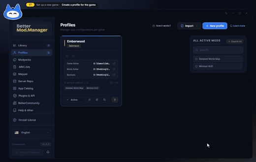
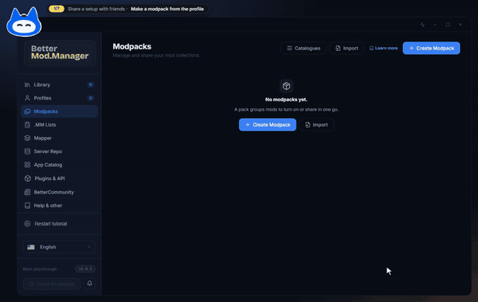
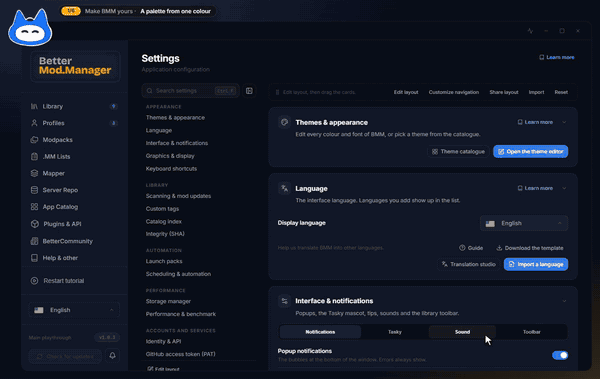
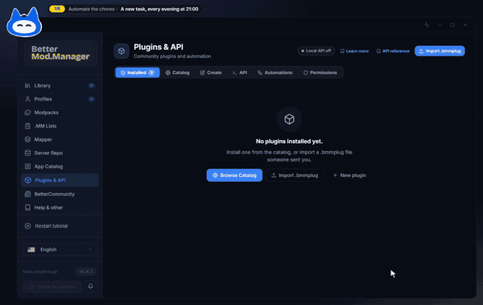
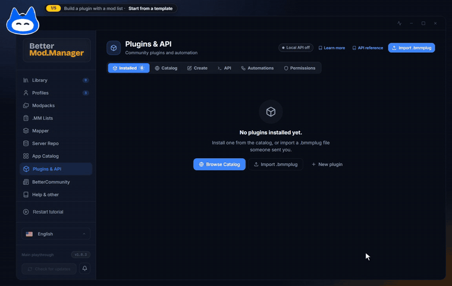
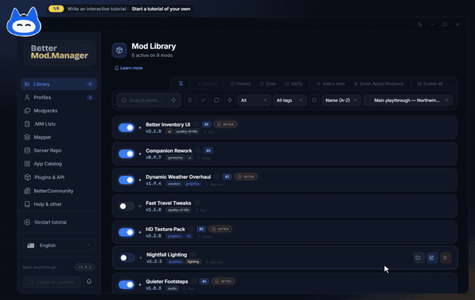
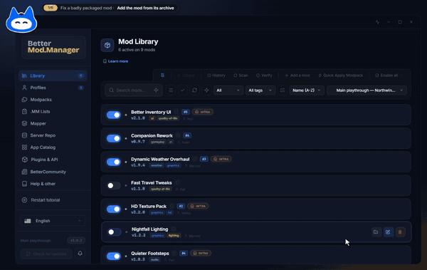
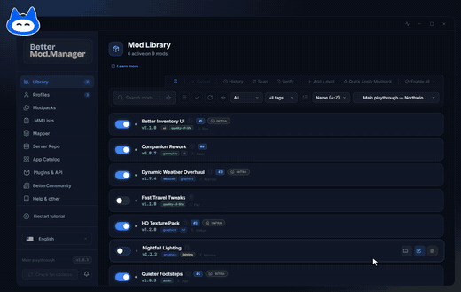
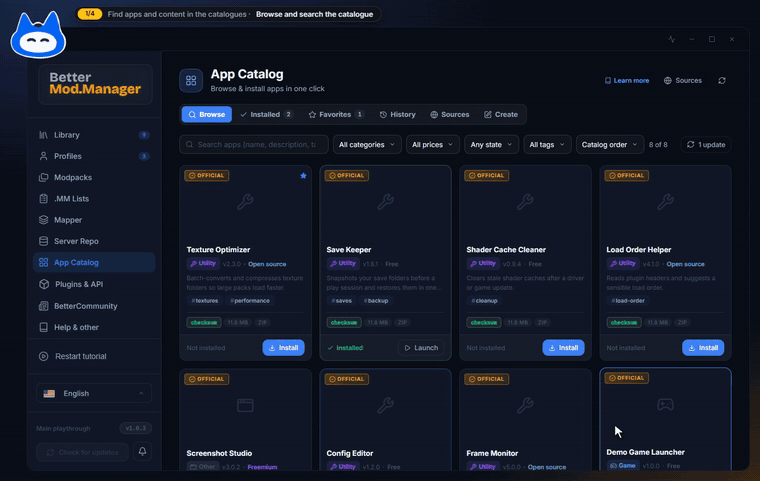
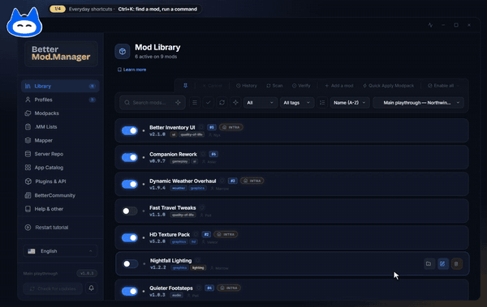

# BMM in pictures

**English** · [Français](VISUALS_FR.md)

A visual tour of Better Mod Manager, area by area. Every picture is the real app, run in the
browser preview with demo data (no real profile, path or account), composed as it sits on a
desktop: the window, with Tasky on its top-left corner.

Short usage clips (GIF, with an MP4 copy) are being recorded for 1.0.3. They will appear under
`.github/gifs/` once they have been reviewed; until then each one is listed below as *coming*,
with its link kept in a comment.

- [Library and profiles](#library-and-profiles)
- [Server repos](#server-repos)
- [Catalogues and apps](#catalogues-and-apps)
- [Activity and tools](#activity-and-tools)
- [Themes](#themes)
- [Plugins and API](#plugins-and-api)
- [Settings](#settings)
- [Stories: BMM used for real](#stories-bmm-used-for-real)

## Library and profiles

| | |
|---|---|
|  **Mod Library**: tagged mods, filters, load order and one switch per mod. |  **Profiles**: one setup per game, or several per game. |
|  **The same Library** in the built-in light theme (Daylight). | |

*Clip coming*: **Resolve a conflict**, from a library badge to the conflicts view: « Make Enhanced
Textures win », the files that change hands, Apply.
<!--  -->

## Server repos

| | |
|---|---|
|  **Sync**: paste a `repo.json` address, preview, then sync. |  **Host**: numbered steps and the running server's card. |

*Clip coming*: **Follow a repo**, Followed repos → « Follow a repo »: a LAN address is typed,
tested (name, version, signature, content) and followed.
<!--  -->

## Catalogues and apps

| |
|---|
|  **App Catalog**: each card shows its state and its next action. |

## Activity and tools

| | |
|---|---|
|  **Activity centre**: every running task, with Cancel, and what finished recently. |  **BMM Tools**: read-only checks, here disk usage per profile and per mod. |

*Clips coming*:

- **Activity centre**: jobs fill the title-bar ring, the panel lists them live, one is cancelled.
  <!--  -->
- **BMM Tools**: Ctrl+K → BMM Tools, search « disk », run Disk usage, copy the result.
  <!--  -->
- **Notifications**: toasts arrive, the bell opens the centre grouped by source, one entry is
  snoozed for an hour, Do not disturb goes on.
  <!--  -->

## Themes

Fourteen built-in themes ship with BMM; [THEMES.md](THEMES.md) shows each one with its id and
explains the editor and the file format. A few of them:

| | | |
|---|---|---|
|  **Default** · dark |  **Daylight** · light |  **Pure Black** · dark |
|  **Newsprint** · light |  **Arctic** · dark |  **Blossom** · light |
|  **Ember** · dark |  **Cobalt** · dark |  **BMM Logo** · light |

*Clip coming*: **Theme editor**, start from a built-in theme, generate a palette from one colour,
fix the contrast the editor flags, save it as a new theme.
<!--  -->

## Plugins and API

No still picture yet for this area.

*Clip coming*: **Create a plugin**, Plugins & API → Create: a template, the identity (the live
preview card follows), the permissions it asks for, with their risk.
<!--  -->

## Settings

| |
|---|
|  **Settings**: an index of every card, with search (Ctrl+F). |

*Clip coming*: **Settings**, Ctrl+F finds a setting; the index edits the page layout (hide a
card, move one), then folds away.
<!--  -->

## Stories: BMM used for real

Each clip is one goal followed from start to finish, with no tutorial on screen. The same takes are interactive recordings (`.bmmreplay`) on the [documentation site](https://freeproject089.github.io/BMM-Docs/), in the page of the feature.

- **Set up a new game**: A profile for Northwind Saga, three mods added from their archives, switched on, the conflict they make settled, and the files in the game folder.
  
- **Share a setup with friends**: The profile becomes a modpack, the modpack is hosted as a Server Repo on the LAN, a friend follows it by its address and syncs.
  
- **Make BMM yours**: A theme made in the theme editor, a navigation bar rearranged with a custom page of your own, and a string translated in the translation studio.
  
- **Automate the chores**: A scheduled task that checks the followed repos and backs up the profiles every evening, previewed before it is saved.
  
- **Build a plugin with a mod list**: Plugins & API → Create: a plugin that ships a list of mods, its permissions, the live preview, and the plugin saved on this PC.
  
- **Write an interactive tutorial**: A tutorial of your own for your friends: steps that point at the interface, a check that waits for an action, tried out, then exported.
  
- **Fix a badly packaged mod**: A mod whose archive puts its files one folder too deep: the Mapper shows where they would land, the root is moved, the result checked and the mod updated.
  
- **Share a mod list and an order**: An activation order settled and kept as a named list with its share code; the mods exported as a .MM list, imported into another profile with the plan of what is new, installed, and switched on in the saved order.
  
- **Find apps and content in the catalogues**: The App Catalog: browse and search, an app’s details, where the list comes from, and a catalogue of your own built in the Create tab.
  
- **Everyday shortcuts**: The command palette finds a mod and runs a command, BMM Tools measures the disk, a launch pack starts the game with its tools, and the docs answer a question without leaving the app.
  

---

The pictures are made by the release tool (`tools/release/`, media step) from the browser
preview; see [tools/release/README.md](tools/release/README.md#media).
