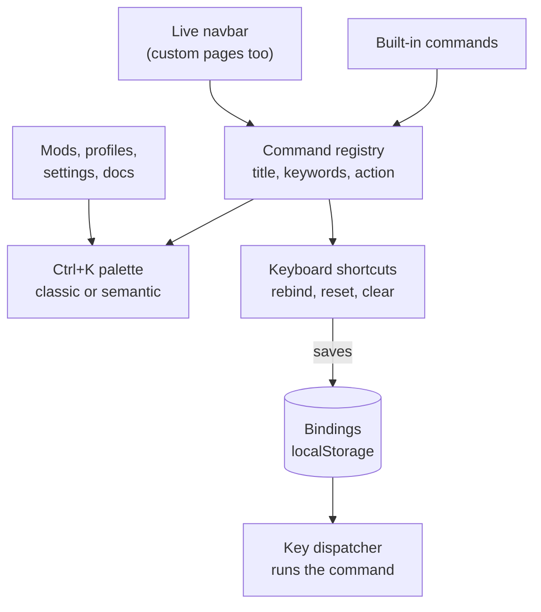

# Command palette & shortcuts

Press <kbd>Ctrl</kbd>+<kbd>K</kbd> (<kbd>Cmd</kbd>+<kbd>K</kbd> on macOS) anywhere in BMM to open the
**command palette** — a single search box laid over every page and every action. Type a few letters,
move with <kbd>↑</kbd> / <kbd>↓</kbd>, and press <kbd>Enter</kbd> to run.

<!-- story:everyday -->

*Everyday shortcuts. The command palette finds a mod and runs a command, BMM Tools measures the disk, a launch pack starts the game with its tools, and the docs answer a question without leaving the app.*

<!-- /story:everyday -->

## What it can reach

The palette is built from the live app, so it always matches what's actually in front of you.

- **Go to any screen** — Library, Profiles, Modpacks, Server Repo, .MM Lists, App Catalog, Plugins,
  BetterCommunity, Help & other, Settings — **including your own [custom navbar pages](doc-page:features/plugins)**.
  A page you pinned yesterday is searchable today; nothing to register by hand.
- **Run an action** without hunting for its button:
    - *Mods* — add a mod, scan the folder, verify integrity, show history, enable/disable all, check for updates.
    - *Profiles* — new profile, import from OvGME / OMM, disable every profile.
    - *Server Repo* — open the Sync or Host tab, browse saved repos, generate a standalone server, start/stop the built-in server, open monitoring, check subscribed repos, copy your creator ID.
    - *Tools & Settings* — check for app updates, restart the onboarding tour, open storage & disk usage, open hashing stats, open [BMM Tools](doc-page:features/tools) or one of its seven tools directly.

## Classic vs. semantic search

Two modes, toggled inside the palette:

- **Classic** — literal substring match on the command's title and keywords.
- **Semantic** — expands your words through a synonym map, so `update` also matches
  *upgrade* / *new version*, and `delete` also matches *remove*. Handy when you know *what* you want
  but not what BMM calls it.

## One registry behind both

The palette and the shortcuts manager are not two lists that have to be kept in step — they are two
views of **one command registry**. A command is registered once, with its title, keywords and the
function it runs; the palette renders it as a search result and the shortcuts page renders it as a
bindable row.

The palette searches more than commands (mods, profiles, themes, plugins, settings and docs
too), but only commands get a shortcut.

That is why a custom page you added yesterday is searchable *and* bindable today without registering
anything by hand, and why a command can never appear in one place and be missing from the other.

## Keyboard shortcuts

The same actions live in **Settings → Keyboard shortcuts** (a card of
its own in **Appearance**). It is a **searchable table**: type a command, a key or a page name in the
search box; a line under it says how many shortcuts there are and how many are changed or yours.
**Changed only** keeps just the rows you touched (a changed default, and your own shortcuts).

- **Rebind.** Click a row's keys, then press the combination you want (:kbd[Esc] cancels). A row
  that was changed carries a *changed* mark; its buttons **go back to the default keys** or
  **remove the keys**.
- **Conflicts.** If another command already answers the same keys *in the same place*, the row says
  « Same keys as … : only one of them runs ». Two shortcuts only clash when they work in the same
  place, so a key can mean one thing on one page and another elsewhere.
- **Reserved combinations.** Keys that belong to Windows or to BMM itself are refused with a
  message; pick another one. A command's own default is never refused.
- **Import / Export** save your shortcuts to a file and load them back, on another PC for example.
  A file that is not a BMM shortcuts file is refused.
- **Reset all** puts every built-in shortcut back to its default keys, after a confirmation.
  **Your own shortcuts stay.**

### New shortcut

**New shortcut** makes a shortcut for something that has none, in three steps:

1. **Action.** Search and pick what the keys will do. There are five kinds, filtered by tabs:
   **Commands** (everything in the palette), **Settings cards** (open a card of Settings),
   **Profiles** (switch to a profile), **Modpacks** (activate a modpack) and **Automations** (run
   an automation).
2. **Keys.** Click the box and press the combination. It is checked at once: reserved keys are
   refused, and if the keys are already used, the dialog says by what and that **saving moves the
   keys here**.
3. **Where it works.** **Everywhere**, or **only on** one page.

Give it a name if the default one does not suit you, then **Save shortcut**. A custom shortcut has
**Edit** and **Delete** buttons on its row. If what it opens is gone later (a deleted profile, say),
the shortcut says so instead of failing quietly.

!!! tip "Custom pages get shortcuts too"

    Your custom navbar pages appear in this list, so you can bind a hotkey that jumps straight to
    one. Rebindings are stored per action, so renaming or reordering the navbar keeps them intact.

!!! note "Use a modifier"

    Combos that include <kbd>Ctrl</kbd> or <kbd>Alt</kbd> are recommended — a plain letter would
    fire while you're typing in a field. While a text field is focused BMM dispatches **only**
    chords carrying Ctrl or Alt; everything else waits until you leave the field.

    <kbd>Shift</kbd> does not count here. <kbd>Shift</kbd>+<kbd>S</kbd> is treated like a bare
    letter, so it will not fire while you are typing — useful if that is what you wanted, and a
    surprise if you expected it to work everywhere.

## Shortcuts that belong to one screen

Most commands work anywhere. A few belong to one place and only exist while it is open: the
scheduler's task editor registers its three mode switches and every key of its [flow
mode](doc-page:features/scheduler#three-ways-to-edit-a-task) this way. They are listed here under **Scheduler**,
they can be rebound like any other, and while their screen has the focus they win over a global
shortcut on the same keys. Elsewhere they do nothing and the palette does not offer them.

## Stopping something that is already running

Enabling or disabling a mod copies files, and a big one takes a while. Two commands stop it:

| Command | Default | What it stops |
|---|---|---|
| **Cancel the running mod operation** | <kbd>Ctrl</kbd>+<kbd>Alt</kbd>+<kbd>Z</kbd> | The one currently copying. Anything queued behind it carries on. |
| **Cancel every queued mod operation** | <kbd>Ctrl</kbd>+<kbd>Alt</kbd>+<kbd>Shift</kbd>+<kbd>Z</kbd> | All of it, including what has not started. |

Both undo what they stop — a half-finished enable is put back the way it was, not left
half-applied — and both are the same actions as the cancel button's click and right-click.

!!! note "Why not Ctrl+Z"

    Shortcuts are dispatched on capture and modified chords fire even while you are typing in a
    field. <kbd>Ctrl</kbd>+<kbd>Z</kbd> bound globally would therefore reach into the
    scheduler's task editor and undo a step of your automation instead of cancelling a copy.
    Rebind it there if you want it — it is your keyboard — but that is why it is not the
    default.

    Pressing either with nothing running says so rather than doing nothing quietly.
