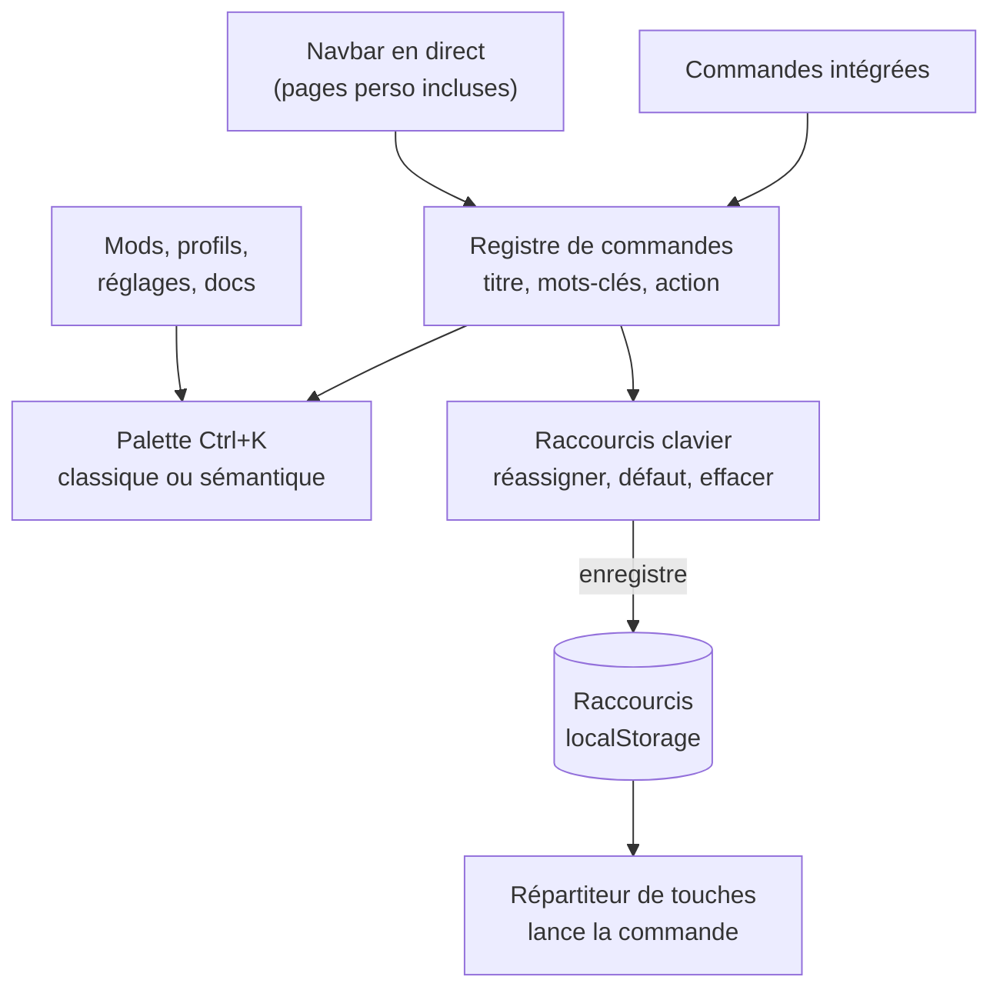

# Palette de commandes & raccourcis

Appuie sur <kbd>Ctrl</kbd>+<kbd>K</kbd> (<kbd>Cmd</kbd>+<kbd>K</kbd> sur macOS) n'importe où dans BMM
pour ouvrir la **palette de commandes** — une seule barre de recherche par-dessus toutes les pages et
toutes les actions. Tape quelques lettres, déplace-toi avec <kbd>↑</kbd> / <kbd>↓</kbd>, et appuie sur
<kbd>Entrée</kbd> pour exécuter.

<!-- story:everyday -->

*Les raccourcis du quotidien. La palette de commandes trouve un mod et lance une commande, BMM Tools mesure le disque, un launch pack démarre le jeu avec ses outils, et la doc répond sans quitter l’app.*

<!-- /story:everyday -->

## Ce qu'elle atteint

La palette est construite à partir de l'app en direct : elle correspond toujours à ce que tu as
réellement devant toi.

- **Aller à n'importe quel écran** — Bibliothèque, Profils, Modpacks, Dépôt Serveur, Listes .MM,
  App Catalog, Plugins, BetterCommunity, Help & other, Paramètres — **y compris tes propres
  [pages de navbar personnalisées](doc-page:features/plugins)**. Une page épinglée hier est cherchable aujourd'hui ;
  rien à déclarer à la main.
- **Lancer une action** sans chercher son bouton :
    - *Mods* — ajouter un mod, scanner le dossier, vérifier l'intégrité, afficher l'historique, tout activer/désactiver, vérifier les mises à jour.
    - *Profils* — nouveau profil, importer depuis OvGME / OMM, désactiver tous les profils.
    - *Dépôt Serveur* — ouvrir l'onglet Sync ou Héberger, parcourir les dépôts enregistrés, générer un serveur autonome, démarrer/arrêter le serveur intégré, ouvrir le monitoring, vérifier les dépôts suivis, copier ton ID créateur.
    - *Outils & Paramètres* — vérifier les mises à jour de l'app, relancer la visite d'accueil, ouvrir le stockage & l'espace disque, ouvrir les stats de hachage, ouvrir les [Outils BMM](doc-page:features/tools) ou directement l'un de leurs sept outils.

## Recherche classique vs. sémantique

Deux modes, à basculer dans la palette :

- **Classique** — correspondance littérale (sous-chaîne) sur le titre et les mots-clés de la commande.
- **Sémantique** — étend tes mots via une table de synonymes : `mise à jour` trouve aussi *upgrade* /
  *nouvelle version*, et `supprimer` trouve aussi *retirer*. Pratique quand tu sais *ce que* tu veux
  mais pas comment BMM l'appelle.

## Un seul registre derrière les deux

La palette et le gestionnaire de raccourcis ne sont pas deux listes qu'il faut garder synchronisées —
ce sont deux vues d'**un seul registre de commandes**. Une commande est enregistrée une fois, avec son
titre, ses mots-clés et la fonction qu'elle exécute ; la palette l'affiche comme résultat de recherche
et la page des raccourcis comme ligne réassignable.

La palette cherche plus que des commandes (mods, profils, thèmes, plugins, réglages et docs
aussi), mais seules les commandes ont un raccourci.

C'est pour ça qu'une page perso ajoutée hier est cherchable *et* assignable aujourd'hui sans rien
enregistrer à la main, et pourquoi une commande ne peut jamais apparaître d'un côté et manquer de
l'autre.

## Raccourcis clavier

Les mêmes actions vivent dans **Paramètres → Raccourcis clavier** (une
carte à part dans **Apparence**). C'est une **table avec recherche** : tape une commande, une touche
ou un nom de page dans la case ; une ligne dessous dit combien il y a de raccourcis et combien sont
modifiés ou à toi. **Modifiés seulement** ne garde que les lignes que tu as touchées (un défaut
changé, et tes propres raccourcis).

- **Réassigner.** Clique les touches d'une ligne, puis appuie sur la combinaison voulue (:kbd[Échap]
  annule). Une ligne modifiée porte la marque *modifié* ; ses boutons **reviennent aux touches par
  défaut** ou **retirent les touches**.
- **Conflits.** Si une autre commande répond déjà aux mêmes touches *au même endroit*, la ligne dit
  « Mêmes touches que … : une seule des deux s'exécute ». Deux raccourcis ne se heurtent que
  s'ils fonctionnent au même endroit : une touche peut donc signifier une chose sur une page et une
  autre ailleurs.
- **Combinaisons réservées.** Les touches qui appartiennent à Windows ou à BMM sont refusées avec un
  message ; choisis-en une autre. Le défaut d'une commande n'est jamais refusé.
- **Importer / Exporter** enregistrent tes raccourcis dans un fichier et les rechargent, sur un autre
  PC par exemple. Un fichier qui n'est pas un fichier de raccourcis BMM est refusé.
- **Tout réinitialiser** remet tous les raccourcis intégrés à leurs touches par défaut, après
  confirmation. **Tes propres raccourcis restent.**

### Nouveau raccourci

**Nouveau raccourci** crée un raccourci pour quelque chose qui n'en a pas, en trois étapes :

1. **Action.** Cherche et choisis ce que les touches feront. Il y a cinq sortes, filtrées par
   onglets : **Commandes** (tout ce qui est dans la palette), **Cartes des Paramètres** (ouvrir une
   carte des Paramètres), **Profils** (passer à un profil), **Modpacks** (activer un modpack) et
   **Automatisations** (lancer une automatisation).
2. **Touches.** Clique la case et appuie sur la combinaison. Elle est vérifiée tout de suite : les
   touches réservées sont refusées, et si les touches sont déjà prises, la fenêtre dit par quoi et
   qu'**enregistrer déplace les touches ici**.
3. **Où ça marche.** **Partout**, ou **uniquement sur** une page.

Donne-lui un nom si celui par défaut ne te convient pas, puis **Enregistrer le raccourci**. Un
raccourci perso a des boutons **Modifier** et **Supprimer** sur sa ligne. Si ce qu'il ouvre a disparu
plus tard (un profil supprimé, par exemple), le raccourci le dit au lieu d'échouer en silence.

!!! tip "Les pages perso ont aussi des raccourcis"

    Tes pages de navbar personnalisées apparaissent dans cette liste : tu peux lier une touche qui
    saute directement à l'une d'elles. Les réassignations sont stockées par action, donc renommer ou
    réordonner la navbar les conserve.

!!! note "Utilise un modificateur"

    Les combinaisons avec <kbd>Ctrl</kbd> ou <kbd>Alt</kbd> sont recommandées — une simple lettre
    se déclencherait pendant que tu tapes dans un champ. Quand un champ de texte est actif, BMM ne
    déclenche **que** les accords portant Ctrl ou Alt ; le reste attend que tu quittes le champ.

    <kbd>Shift</kbd> ne compte pas ici. <kbd>Shift</kbd>+<kbd>S</kbd> est traité comme une lettre
    seule : il ne se déclenchera pas pendant la saisie — pratique si c'est ce que tu voulais, et
    surprenant si tu l'attendais partout.

## Des raccourcis qui appartiennent à un écran

La plupart des commandes marchent partout. Quelques-unes appartiennent à un endroit et n'existent
que quand il est ouvert : l'éditeur de tâches du planificateur enregistre ainsi ses trois modes et
chaque touche de son [mode Flux](doc-page:features/scheduler#trois-facons-de-modifier-une-tache). Elles sont
listées ici sous **Planificateur**, se relient comme les autres, et quand leur écran a le focus
elles l'emportent sur un raccourci global sur les mêmes touches. Ailleurs elles ne font rien et la
palette ne les propose pas.

## Arrêter quelque chose qui tourne déjà

Activer ou désactiver un mod copie des fichiers, et un gros mod prend du temps. Deux commandes
l'arrêtent :

| Commande | Par défaut | Ce qu'elle arrête |
|---|---|---|
| **Annuler l'opération en cours** | <kbd>Ctrl</kbd>+<kbd>Alt</kbd>+<kbd>Z</kbd> | Celle qui copie en ce moment. Ce qui attend derrière continue. |
| **Annuler toutes les opérations** | <kbd>Ctrl</kbd>+<kbd>Alt</kbd>+<kbd>Maj</kbd>+<kbd>Z</kbd> | Tout, y compris ce qui n'a pas commencé. |

Les deux défont ce qu'elles arrêtent — une activation à moitié faite est remise comme avant,
pas laissée à moitié appliquée — et ce sont les mêmes actions que le clic et le clic droit du
bouton Annuler.

!!! note "Pourquoi pas Ctrl+Z"

    Les raccourcis sont distribués à la capture, et un accord avec modificateur part même
    pendant que tu tapes dans un champ. <kbd>Ctrl</kbd>+<kbd>Z</kbd> lié globalement irait donc
    dans l'éditeur de tâches du planificateur annuler une étape de ton automatisation au lieu
    d'arrêter une copie. Relié-le si tu veux — c'est ton clavier — mais c'est pour ça que ce
    n'est pas le défaut.

    Appuyer dessus sans rien en cours te le dit, plutôt que de ne rien faire en silence.
